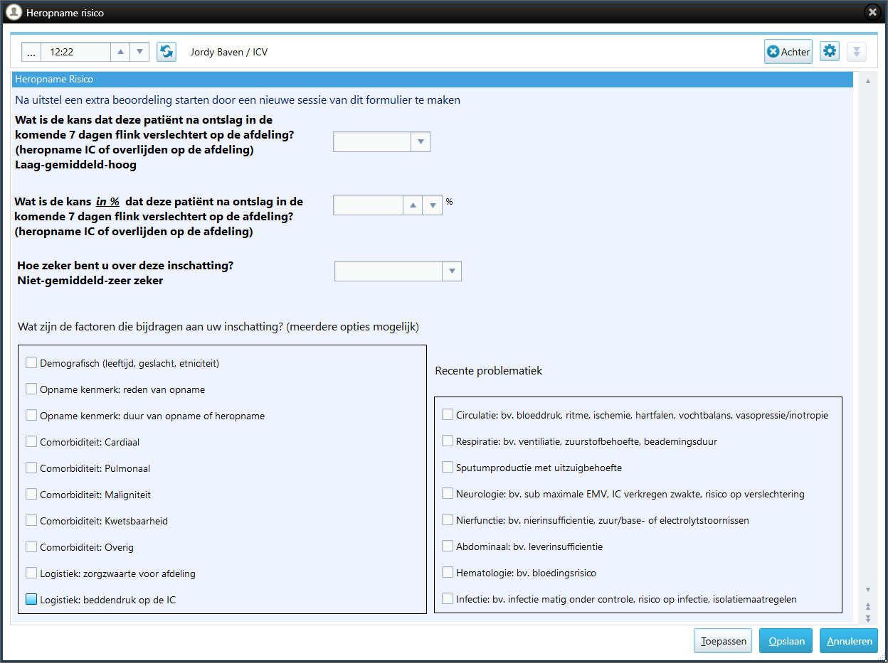
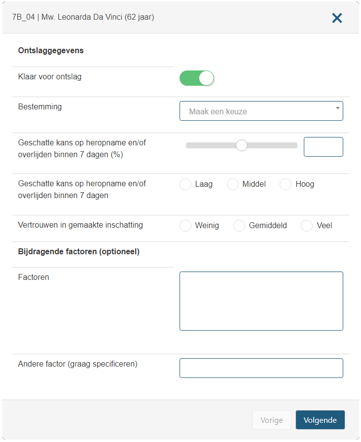

# Algo_vs_Doc

This repository contains code for analyzing the performance of an artificial intelligence system vs. intensivist expertise 
in predicting readmission or death after ICU discharge. The study evaluates the predictions by Pacmed Critical ('algo') and Intensivists ('docs') of two academic medical centers: 
[Amsterdam UMC, location VUmc](https://www.vumc.nl/) (VUmc), Amsterdam and [Leiden University Medical Center](https://www.lumc.nl/) (LUMC), Leiden, both in the Netherlands.

## What is Algo Versus Doc?

The Algo Versus Doc study was the first study around the implementation phases of Pacmed Critical Discharge.

During this period, intensivists (ICU consultants, 'docs') made predictions of the likelihood of readmission or mortality after discharge from the ICU. In the background, the model was doing predictions but intensivists were not able to see the Pacmed Critical UI or any of its predictions. Both VUmc and LUMC took part in study.

Analysis notebooks write local CSV results to `results/summaries/` and `results/plot_data/`.
The presentation notebook uses those results and the local analysis datasets to write SVG figures
to `figures/`, submission PDFs to `results/submission_figures/`, and editable Word tables to
`tables/`. Generated CSV results are not part of the public release. Statistical calculations
remain separate from document formatting.

The shared intermediate-table contract, including study-cohort and follow-up context flags, is documented in [the CDM-lite contract](docs/cdm-lite-contract.md).

## What did we investigate?

Who is more accurate in predicting likelihood of readmission or mortality after discharge: the intensivist or the AI model?
Do the intensivist predictions improve by combining them with predictions by the AI model?

## Who did the analyses?

[Patrick Thoral](https://github.com/patrickthoral) (VUmc, currently OLVG) and [Anne de Hond](https://github.com/annedh93) (LUMC, currently UMC Utrecht) were the primary researchers. They were in charge of the analysis and developed the analysis code in this repository. The preprocessing to generate the data on which they could do their analyses was made by [Daan de Bruin](https://github.com/daandebruin) (Pacmed) initially, and updated by Patrick Thoral for final manuscript preparation.

## What is the input to the code in this repository?

- The forms filled in by the physicians containing their predictions, both for VUmc and LUMC
- The df model of the patients in scope, containing the features and outcomes required by the model
- The predictions done by the model, for VUmc the production predictions, for LUMC the predictions from the calibration code

LUMC intensivists documented their risk estimates and factors directly in MetaVision, the patient data management system, using a custom made form by Jordy Baven, Application Administrator, LUMC.




The predictions from VUmc were stored in a separate database (VUmc) using a web application developed by Patrick Thoral using an interface with the Epic Systems EHR. The backend for retrieving real-time data from the EHR was developed by Ronald Driessen, Clinical IT Specialist, VUmc.



## Getting started
This repository uses Python version 3.12.10 as its main programming language. Python package dependencies were managed using Poetry.


### Install Python
Install python from the official website: https://www.python.org/downloads/release/python-31210/

### Install poetry
Poetry is a Python packaging and dependency manager. Depending on your operating system, the installation procedure differs, so you it is recommend the official docs: https://python-poetry.org/docs/

For VS Code and possibly other IDEs: to allow detection of your virtual enviroment, the environment should be stored 
within the project folder. 

From a terminal/command prompt:
```bash
poetry config virtualenvs.in-project true
```

### Setup an environment 

To setup an environment for Python 3.12, and to install the dependencies into this environment, fom a terminal/command prompt type:

```bash
poetry install
```

This will install a clean environment in the (hidden) [`.venv`](./.venv/) containing the required packages including Jupyter Notebook, pandas and scikit-learn.

When actively contributing, install the Git pre-commit hook:

```bash
poetry run pre-commit install
```

This wil strip output from Jupyter notebooks, format Python files, and check for common coding errors at every commit (e.g. at pre-commit). To run those manually, run

```bash
poetry run pre-commit run --all-files
```


### Running notebooks with parameters

Some notebooks contain a cell marked as `parameters`. The values in this cell are the defaults used when running the notebook interactively.

The same notebook can be executed non-interactively with [Papermill](https://papermill.readthedocs.io/), which is included in the Poetry environment. Papermill allows values in the `parameters` cell to be overridden without modifying the original notebook.

Run the notebooks in numerical order. Their main outputs and dependencies are:

1. `1-create-analysis-dataset.ipynb` creates the hospital analysis datasets.
2. `2-cohort-enrolment.ipynb` creates enrolment and prediction-availability results.
3. `3-baseline-characteristics.ipynb` creates Table 1 and subgroup summaries.
4. `4-analysis.ipynb` creates performance estimates and bootstrap results.
5. `5-figures-and-tables.ipynb` reads the local analysis datasets and results from notebooks 2, 3, and 4, including local case-level inputs, and creates the publication figures, separate Word tables, and combined Supplemental Digital Content. It cannot run from a fresh public checkout without those inputs.

After installing the project dependencies with `poetry install`, a short development analysis can
be run from the project root with the notebook default of 100 bootstrap replicates:

```powershell
poetry run papermill notebooks/4-analysis.ipynb analysis-development.ipynb
```

Override the bootstrap parameter for the final analysis:

```powershell
poetry run papermill notebooks/4-analysis.ipynb analysis-final.ipynb -p n_bootstraps 10000
```

After notebooks 2, 3, and 4 have completed and the required local case-level inputs are available,
the presentation notebook reads their saved numerical results and does not repeat the bootstrap
analysis:

```powershell
poetry run papermill notebooks/5-figures-and-tables.ipynb figures-and-tables.ipynb
```

The names supplied with `-p` must correspond to variables defined in the notebook's `parameters` cell. Values that are not overridden retain the defaults specified in the notebook.

### Availability of data and materials
This repository contains the Jupyter [notebooks](./notebooks/) and [algo_vs_doc](./algo_vs_doc/) Python module to analyse the processed study data. Initially, the analyses were performed independently by both research due to legal Data Sharing agreement restraints but finally pooled for combined analyses of both hospitals. 

The hospital analysis datasets are not included in this public repository to mitigate privacy risks
and protect patient confidentiality. See [data/README.md](data/README.md) for their expected local
paths. The datasets analysed are available for researchers on reasonable request directed to
Patrick Thoral ([@patrickthoral](https://github.com/patrickthoral)).

Generated results, including resampling records, remain local under `results/`. See
[results/README.md](results/README.md) for the output layout and notebook 5 inputs.
